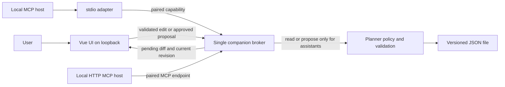

# Connecting an LLM app to Next168

Research date: **2026-10-23 (America/Bogota)**. Three-month review window: **2026-07-23–2026-10-23**, inclusive. Sources accessed on 2026-10-23 in that timezone; the live HTTP checks occurred after midnight UTC on 2026-10-24. Scope: [Next168 #3](https://github.com/crexative/next168/issues/3). This is a research recommendation, not an implemented integration or an assertion that clients were tested.

## Recommendation and fallback

**Recommend one optional local companion that owns a versioned JSON data file, serves the built Vue app on loopback, and exposes the same planner operations through local MCP.** Use stdio adapters for desktop/CLI hosts and authenticated Streamable HTTP for hosts that require HTTP. Keep the existing browser-only planner available without an account. Package the companion as a Node CLI for a prototype and the same implementation as a Claude Desktop `.mcpb` for easier installation. A terminal command is an installation burden, not a zero-install experience.

**Fallback: explicit JSON snapshot export + a copyable prompt, followed by importing a proposed change set and approving its diff in Next168.** Ship this baseline first; it works with any assistant that accepts text or files, including browser-only chat products. Export/import and the approval UI are proposed work, not existing features in this checkout.

The companion is preferable to a permanently open browser bridge because it establishes one storage owner, works when the tab closes, avoids shared-file writers, and uses widely documented local MCP hosts. It adds no Next168 account, hosted database, subscription, public server, or tunnel. Its installation and operating-system support must be validated before calling it suitable for non-technical users.

There are two different meanings of “local”: **local storage/tool execution** and **local inference**. Claude and ChatGPT cloud conversations still receive the tool results or snapshots the user shares. A local MCP server does not make their inference offline. For an entirely local workflow, use a downloaded model in LM Studio or a local Ollama host with an MCP-capable client, or the separately planned in-browser assistant. Cloud assistants remain optional, explicitly disclosed data sharing. [S6] [S7] [S8] [S14] [S15]

Do not promise a direct browser-to-every-chat-app connection. Claude web connectors originate in Anthropic's cloud. ChatGPT now documents both Secure MCP Tunnel and restricted desktop-local plugins, so “ChatGPT always requires a public server” is also too broad. Neither establishes a universally available, entirely local Next168 connection. [S7] [S8] [S9] [S10]

## Fit to the inspected code

Inspected source/base: **`05d781d9a884db89d0c42d87d6e9cdd364bd4a5c`**, equal to the local `origin/main` and live `git ls-remote origin refs/heads/main` during research. Normal fetch was attempted but the sandbox denied writes to the shared Git metadata; no base integration was performed. Branch: `chore/#3-research-llm-connectivity`. Files read: every file in `src/repositories/`, `src/types/index.ts`, `src/stores/weekStore.ts`, and supporting validation/time utilities, Vite configuration and deployment workflow.

| Observed contract | Consequence for the proposal |
| --- | --- |
| [`WeekData`](../../src/types/index.ts) contains only `categories` and `timeBlocks`. There is no task entity, dated week, timezone, actual-time log, revision, or schema version. | Expose a **recurring weekly template**. Do not invent dated history or report scheduled time as measured actual time. Defer `list_tasks` until tasks exist. |
| [`IWeekDataRepository`](../../src/repositories/IWeekDataRepository.ts) has async `save`, `load`, `clear`, `exists`; `save` returns a boolean. The factory selects [`LocalStorageRepository`](../../src/repositories/LocalStorageRepository.ts), key `next168-data`. Its loader casts parsed JSON without runtime schema validation. | Add a localhost repository adapter for companion mode; retain localStorage for browser-only mode. Validate all imported/loaded data. A whole-document boolean save cannot express revision conflicts; the companion needs an explicit conditional commit boundary. |
| [`SupabaseRepository.example.ts`](../../src/repositories/SupabaseRepository.example.ts) is a commented demonstration with stub responses. | It is not an operational backend and is unnecessary for this local-only recommendation. |
| [`weekStore.ts`](../../src/stores/weekStore.ts) mutates Pinia arrays, calls `saveToStorage()` without awaiting it, and returns synchronous success. Failed persistence only logs an error. | Do not expose these actions unchanged as durable remote writes. Prepare a candidate, validate it, commit durably, then publish the new state and report success. Revert/display failure when persistence fails. |
| Days are Sunday `0` through Saturday `6`. A block occurs on the union of `dayOfWeek` and `repeatDays`; stats multiply duration by the number of unique days. | Preserve this convention and IDs. Recompute duration and stats; never trust model-supplied totals. |
| Validation checks titles, categories, overlap and category budgets. The duration utility wraps negative differences across midnight, while overlap checks compare same-day intervals. Category-limit reduction sums each block once, unlike repeated-day statistics. | These are inspected inconsistencies, not runtime-reproduced defects. Before automated writes, add discriminating acceptance checks for repeat-day budgets and cross-midnight conflicts. Until resolved, reject ambiguous overnight proposals with a visible error rather than silently reinterpret existing data. |
| [`vite.config.ts`](../../vite.config.ts) uses `base: '/next168/'` and development `host: true`; the workflow deploys only from `main`. No service-worker registration was found in the inspected app/config. | Serve production assets with a compatible base path; do not ship the LAN-exposed Vite development server as the companion. Existing localStorage persistence alone does not establish offline reload/install support. |

Browser localStorage belongs to an origin, not an app name. There is no supported MCP API for an arbitrary Node process to read another application's browser storage. Reading browser profile files would be fragile, invasive, and outside the proposed interface. `https://next168.app`, `http://localhost:<port>` and `http://127.0.0.1:<port>` have separate storage; even changing the port changes the origin. [S20]

Migration therefore starts with a user-triggered export **on the existing origin**, a backup, and an explicit import into the companion. Never interpret the companion's initially empty storage as permission to overwrite the hosted planner. The two modes are separate workspaces unless the user deliberately transfers data; there is no silent bidirectional sync.

## MCP today: protocol and authorization

The official `latest` URL resolves to **revision `2026-07-28`**, superseding `2025-11-25`. MCP is JSON-RPC, independent of where inference runs. Protocol revision support and transport support are separate compatibility questions. [S1]

| Transport | Current meaning | Next168 use |
| --- | --- | --- |
| **stdio** | A host launches a subprocess; messages are newline-delimited on standard streams. Keep protocol output on stdout and diagnostic logs on stderr. | Broad local desktop/CLI compatibility; a small adapter calls the single companion broker. It must not become a second file writer. |
| **Streamable HTTP** | Client messages POST to one MCP endpoint; responses use JSON or request-scoped SSE. SSE here is a response encoding, not the old separate HTTP+SSE transport. | Loopback endpoint for HTTP clients. A remote/cloud caller needs network reachability or an explicit supported tunnel. |
| **Legacy SSE / custom transports** | Older clients still document SSE. Other bindings are possible but require agreement on framing and semantics. | Do not add a new WebSocket MCP dialect merely to serve this planner. A private tab bridge could use WebSocket internally without claiming standard MCP transport compatibility. |

Transport definitions: [S2]. The July revision removes protocol-level sessions and the initialization handshake, adds per-request version/capability metadata and `server/discover`, and moves tasks into an extension. Older examples using `initialize` are not current-wire specifications. Use an SDK with tested backward compatibility instead of implementing negotiation manually. The selected SDK version and every target client's July-revision interoperability are **UNKNOWN** until an executable compatibility spike; a documented MCP checkbox is insufficient. [S5]

**Authorization is optional in the protocol, not optional in the product threat model.** For protected HTTP MCP, the spec describes OAuth 2.1 resource servers, protected-resource metadata, authorization-server discovery, PKCE-related binding and issuer validation, resource indicators/audience checks, and bearer tokens. Apply its requirements when implementing that flow; do not forward arbitrary upstream tokens or confuse an OAuth client identity with end-user permission. Stdio should not implement the HTTP OAuth flow; credentials, if needed, come from its environment. A local planner does not need a provider API key merely to expose MCP tools. [S3]

Streamable HTTP servers must validate any supplied `Origin` and reject an invalid one with 403; local listeners should bind to loopback and authenticate connections. For this product, require a paired capability token even on loopback, allowlist the exact `Host`/port and expected UI origin, and reject unapproved origins before dispatch. Native clients may omit `Origin`: that is not proof of trust and never replaces the token. An app-private loopback bearer token is not a claim of full MCP OAuth interoperability; verify clients support the configured header. [S4]

## Client compatibility, as documented on the research date

“Local” below describes where the MCP connection runs, **not** whether the chosen model is local. These are official-document claims unless marked otherwise; no accounts or client installations were exercised. Publication/update dates are recorded in the source register; undated living docs are not assigned invented release dates.

| Client | Local server support / transport | User setup and constraints | Consequence for Next168 |
| --- | --- | --- | --- |
| **Claude Desktop** | Yes: local stdio configuration and desktop extensions. `.mcpb` packages a local server; Node ships with Claude on macOS/Windows. [S6] [S17] | Install Desktop; Settings → Desktop app → Extensions → advanced installation → select a trusted `.mcpb`, or configure `claude_desktop_config.json` with a command/runtime. Organization policies can restrict extensions. | Best non-technical target for a packaged companion. Install does not grant a sandbox: keep server privileges narrowly used. Local extension is distinct from a cloud-brokered connector. |
| **Claude Code, running locally** | Yes: local stdio; documented HTTP, SSE and WebSocket options. [S18] | Install/configure the CLI; add the reviewed command with `claude mcp add --transport stdio ... -- <command> <args>`, or an HTTP URL; inspect `/mcp` and permissions. | Works with stdio adapter. A cloud/SSH/container session does not automatically share the laptop's loopback or file. |
| **claude.ai custom connectors**, including connectors selected inside Desktop | Remote connector connections originate from Anthropic's infrastructure; server must be internet-reachable. [S7] | Add a custom web connector URL and authentication under the applicable account/workspace policy. | A bare localhost URL cannot reach this companion. No direct local stdio path in claude.ai. Use the snapshot fallback under the current scope. |
| **ChatGPT web custom MCP**, historically developer mode / connectors / apps | Current docs expose custom MCP as **plugins**, using streaming HTTP or SSE via Server URL, or **Secure MCP Tunnel**. No direct browser-launched stdio command. [S8] [S9] | Add custom MCP in ChatGPT Plugins; select URL or Tunnel; configure auth and permissions. Tunnel additionally requires `tunnel-client`, a tunnel identity, runtime API key and Platform roles/workspace association. Older developer-mode instructions are not proof of current entitlement. | Plain `localhost` is not a generally supported cloud URL. A tunnel can reach a private local MCP server without a public listener, but adds OpenAI infrastructure/accounts and data transmission. Exclude it from the local-only default. Exact plan/account access is UNKNOWN without live testing. |
| **ChatGPT Apps SDK / plugin UI** | Optional UI layered on MCP, not a browser-storage transport. Public submission requires a stable public HTTPS endpoint; private testing may use the supported tunnel. [S10] | Build server and optional UI, connect/test, then satisfy distribution requirements. | Rendering a widget in ChatGPT does not grant access to next168.app's localStorage. No hosted integration proposed here. |
| **ChatGPT Desktop, desktop-only plugins** | Official docs now describe local **stdio** MCP packages, installable in Desktop and usable in locally running threads. **Local submissions are limited to approved partners.** [S11] | Package server/dependencies and local command; obtain organization allowlisting and submission approval. | A conditional future distribution route, not a verified open installation path for every Next168 user. General custom local sideload entitlement is UNKNOWN. |
| **Gemini CLI** | Yes: `command` for stdio, `httpUrl` for Streamable HTTP, `url` for SSE. [S12] | Install CLI/runtime, add `mcpServers` in `settings.json` or use `gemini mcp add`; keep confirmations enabled (`trust: false`); check `/mcp list`. | Compatible local host; Gemini cloud inference still requires connectivity and the user's access. |
| **Cursor Desktop** | Yes: stdio, local/remote SSE and Streamable HTTP. [S13] | Add a reviewed command/URL to global `~/.cursor/mcp.json` or project `.cursor/mcp.json`; review tool calls. | Compatible; remote agent execution must have its own connectivity. |
| **VS Code agents / Copilot** | Yes: stdio, HTTP and SSE; configuration/forwarding depends on the selected harness. [S16] | Run **MCP: Add Server**; select command or HTTP and correct configuration destination. VS Code `mcp.json` uses `servers`; portable `.mcp.json` uses `mcpServers`. | Compatible local configuration. Do not assume a dev container's localhost is the laptop, or that every harness forwards prompted secrets/sandbox settings. |
| **LM Studio** | Yes: local and remote MCP since **0.3.17**, with remote support from **0.3.17 b10**; Cursor-style `mcp.json`. [S14] | Install, download a capable local model, Program → Install → Edit `mcp.json`, add trusted server command/URL. | Strong fully local candidate after downloads; tool-use reliability and hardware suitability need testing. |
| **Ollama itself** | Its documented tool-calling API lets the calling application execute requested functions; this alone does not establish a generic MCP host. [S15] | Install Ollama/download model, then choose an MCP-capable host or implement the tool loop. | Do not tell users to put MCP configuration into an assumed Ollama MCP settings file. Bare Ollama MCP-host support is UNKNOWN in the inspected docs. |
| **Open WebUI with Ollama** | Native MCP **Streamable HTTP**, starting **0.6.31**; native stdio/SSE are not supported. [S19] | Run Open WebUI and Ollama locally; admin adds an MCP connection under Integrations. Optional `mcpo` translates stdio to OpenAPI, adding another process. | Use companion HTTP directly. In Docker, server-side loopback points to the container; prove the route without opening the planner to the LAN. Other Ollama clients must be evaluated individually. |

## Browser-side tools and bridges

**WebMCP:** an evolving W3C Web Machine Learning Community Group proposal, not a W3C Recommendation or a universal MCP endpoint. The current explainer registers JavaScript tools through **`document.modelContext.registerTool()`**, with abort signals for lifecycle cleanup. Older `navigator.modelContext` material reflects an earlier API; detect the actual runtime rather than assuming either shape. Chrome documents an origin trial starting in Chrome 149 and a testing flag, with its main guide updated **2026-10-07**. The standards explainer currently scopes the imperative API; Chrome also describes experimental declarative form tooling. Treat that difference as a spec/implementation distinction. No cross-browser production-support claim is established here. [S21] [S22]

**Can a page expose tools without a local process? Yes, to a compatible in-browser agent.** Tool callbacks can query Pinia/localStorage within the page's existing origin. A same-page local model can also call ordinary application functions without adopting WebMCP. Neither mechanism automatically makes the page reachable from Claude Desktop, claude.ai or ChatGPT. A generic web page cannot listen as a TCP/stdio MCP server for those hosts. Tab/document lifetime and browser mediation remain dependencies. [S21] [S23]

**MCP-B / browser bridges:** the project's own sources describe polyfills and translation between WebMCP tools and MCP, with browser transports and extensions. It is third-party infrastructure, not the W3C API itself. A polyfill can implement an API shape but cannot create browser privileges or an external client's connection. Its current project overview distinguishes MIT libraries, a non-open-source connecting extension, and an AGPL community proof of concept; verify the exact artifact's license before adoption. “Works with ChatGPT” in a project's overview does not prove direct local ChatGPT connectivity. Exact current external-client pairing, extension permissions, local native/relay requirements and offline behavior are **UNKNOWN** without following and testing that distribution's installation path. [S24] [S25]

**Chrome extensions:** a browser-aware assistant or extension can discover page tools, or use a content-script/message bridge. An external desktop MCP host still needs a supported transport, often a native host or localhost helper. Limit host permissions to the intended Next168 origin, validate message source/origin and tab identity, and never accept a universal `postMessage` command executor. Chrome's tool-inspector extension is a development aid, separate from Gemini in Chrome; it can send prompts to a cloud model or use an experimentally enabled local Prompt API. It is not evidence that every favorite LLM app can discover the planner. [S22]

## Option matrix

Effort below is a relative engineering judgment, **not a measured delivery estimate**. “Offline” assumes assets, runtime and any model have already been installed; the current hosted app has no verified offline-reload guarantee. All alternatives must use the same validation and proposal policy.

| Option | Non-technical user's installation/use | Compatible clients | Security / failure boundary | Offline behavior | Relative effort / verdict |
| --- | --- | --- | --- | --- | --- |
| **(a) Companion owns JSON; serves UI + MCP** | Prototype: install Node, run a reviewed, version-pinned `npx` command, open its localhost UI, import backup, configure assistant. Packaged Desktop route: install `.mcpb`, open companion UI and import. | Local stdio hosts above; HTTP hosts via loopback. Browser-only cloud connectors need an out-of-scope public route/tunnel or snapshot. | One broker/file writer; paired tokens; loopback/Host/Origin checks; UI-only commit authority; atomic persistence and backups. Package supply chain and process lifetime are real costs. | UI/data/tools work while companion runs, even with tab closed for reads/proposals. Approval waits for UI. Inference offline only with local model. | **Medium–high; recommended live connection.** Owns lifecycle, packaging and storage, but avoids sync and experimental browser APIs. |
| **(b) Browser remains authority; localhost/WebSocket bridge** | Install helper/configure local MCP, open original Next168 tab, explicitly pair that tab; keep it available. | Local MCP hosts through helper. Cloud products still need an additional supported relay; WebSocket alone does not solve this. | Exact allowed page origin, authenticated WebSocket upgrade/messages, one bound workspace/tab, replay protection and revocation. Background suspension or a closed tab returns `PLANNER_UNAVAILABLE`, not stale success. | Data remains browser-local; tools stop when tab sleeps/closes. Hosted-page reload and local inference require their own offline preparation. | **Medium–high; not preferred.** Avoids migration but makes tab lifetime and cross-origin local networking core requirements. |
| **(c) File System Access JSON sync** | In a supporting browser, choose/create a JSON file, grant write access, configure helper to that same file, reopen/regrant permissions as needed. | Local MCP hosts reading the file. Assistant without MCP can manually read an exported snapshot. Browser/file-picker support limits reach. | User-picked file scope is useful; origin-private storage is not an ordinary shared OS file. Browser and helper writes race: revisions, conflict UI and a single writer/locking scheme are necessary. Do not call two-way writes “sync” without these. | File remains available without tab; browser needs permissions and reload/polling to see external changes. Assistant writes still await approval. | **Medium–high; not preferred.** File permissions and concurrent writers outweigh eliminating localhost networking. Use download/upload fallback where native pickers are unavailable. [S26] |
| **(d) WebMCP in-page tools** | Open page in compatible browser/agent; during experimentation enable a flag or use a valid origin trial. No Next168 native helper for a browser-local agent. | Compatible browser agents; not arbitrary external MCP hosts without a bridge. | Browser origin/permission mediation plus application validation; exposed tool scopes must be narrow. Page automation can potentially press approval controls. | Callbacks work with an available page/local model; no tab, no tools. Cloud browser agents still need network. | **Low–medium as optional enhancement; high/UNKNOWN for universal client support.** Reuse operations later, do not make experimental API a prerequisite. |
| **(e) BYO provider API key in browser** | Create a provider account/key (possibly billing), paste into Next168, choose provider/model. This creates an embedded assistant, not a connection to the user's existing chat app/subscription. | Provider APIs via Next168, not Claude/ChatGPT app MCP configurations. | CORS per endpoint; keys exposed to executing scripts/XSS/extensions; never bundle company keys or silently persist user keys. Data leaves device. | Planning persists; inference fails without internet. Local Ollama API is a separate optional host, not a paid provider API. | **Medium; outside the free/local-only default.** No server needed where CORS permits, but accounts, cost and key UX conflict with the stated baseline. |
| **(f) Snapshot + prompt + reviewed import** | Export selected planner JSON, inspect it, paste/upload into chosen assistant, copy/download proposed changes, import and approve in planner. No helper or extension. | Any chat accepting sufficient text or JSON; exact attachment/context limits vary. | Deliberate disclosure, stale-base protection, untrusted JSON validation, no executable imports. Local copy/paste is not automatic authorization to send data to a cloud assistant. | Export/import works with loaded/offline-capable app; inference offline only with local assistant. | **Low; fallback and first deliverable.** Manual, stale and less convenient; reliable across clients without a live connection. |

Public HTTPS → localhost bridges must also contend with browser local-network permissions and mixed-content behavior. Chrome introduced Local Network Access permission gating in Chrome 142; CORS configuration alone is not sufficient. Browser/version-specific WebSocket behavior remains a test item. Serving the UI and API from the same loopback origin in (a) reduces these dependencies. [S27]

### BYO API key: CORS evidence and limits

No credentials were read, supplied or created; no inference requests were made. These were **unauthenticated `OPTIONS` probes**, with `Origin: https://next168.app`, requested method `POST` and the headers below. They establish preflight behavior only, not successful authenticated calls, organizational policy, streaming behavior or a durable CORS guarantee.

| Provider | Endpoint and requested headers | Observed preflight | Official guidance / conclusion |
| --- | --- | --- | --- |
| OpenAI | `https://api.openai.com/v1/responses`; `authorization,content-type` | HTTP 200; allowed origin `*`, POST and requested headers. | Official API auth guidance says secret keys must not be exposed in browsers/apps. Technical preflight permission is not a security endorsement. [S28] |
| Anthropic | `https://api.anthropic.com/v1/messages`; `x-api-key,anthropic-version,content-type,anthropic-dangerous-direct-browser-access` | HTTP 200; allowed origin `*`, POST and requested headers. | Official SDK disables browser use by default; `dangerouslyAllowBrowser` opts in. Current SDK source supplies the dangerous-browser header. Account-policy/authenticated behavior is untested. [S29] [S30] |
| Gemini | `https://generativelanguage.googleapis.com/v1beta/interactions`; `x-goog-api-key,content-type` | HTTP 200; allowed origin `https://next168.app`, POST and requested headers. | Official key guidance recommends a backend proxy rather than production client-side keys. Do not generalize this result to every Google/Vertex endpoint. [S31] |
| OpenRouter | `https://openrouter.ai/api/v1/chat/completions`; `authorization,content-type` | HTTP 204; allowed origin `*`, POST and both headers in its allowlist. | Official docs describe bearer keys, app credit limits and OAuth flows. Browser feasibility still does not provide free inference or reuse a ChatGPT/Claude subscription. [S32] |

First probe batch: **2026-10-24T04:37:40Z**; Gemini's current documented Interactions endpoint was checked in a subsequent probe in the same session. To repeat, send an `OPTIONS` request to the exact endpoint with the above Origin, `Access-Control-Request-Method: POST` and `Access-Control-Request-Headers` values, then inspect the status and `Access-Control-Allow-*` response headers. Do not add an Authorization/API-key value. A curl/Python preflight does not exercise browser enforcement; a real-browser authenticated spike needs separately authorized credentials and spending.

If BYO keys are offered later, use session memory by default with explicit forget/revoke guidance; exclude keys from snapshots, localStorage, logs, analytics, URLs and error reports. “Encrypted in localStorage” does not protect a key from malicious JavaScript that also obtains its decryption capability. Pin trusted dependencies, set a restrictive CSP, avoid third-party scripts in the planner origin, limit submitted data and request output, and show the provider before sending. Moving credentials into a local companion can reduce browser exposure but introduces a different key-management feature; it is not required for MCP.

## Recommended architecture in detail



1. **One owner.** A companion process serves built assets and a small HTTP API bound to `127.0.0.1` (and explicit loopback IPv6 only if supported/tested). It alone reads/writes its chosen per-user planner file. Per-client stdio adapters forward to it; they never edit JSON themselves. Concurrent startup must refuse a second writer or attach to the already authenticated broker. Keep the companion a foreground user-controlled process initially, with a clear shutdown action; do not introduce an always-running daemon for the prototype.
2. **Repository integration.** In companion mode, select a `LocalCompanionRepository` behind the existing interface. Preserve `WeekData` payload compatibility, but route edits through an asynchronous application service that supports `expectedRevision` and durable errors. Browser-only mode keeps the current repository. Extract shared pure validation/derivation from the Vue-specific state path; do not duplicate business rules in an MCP handler.
3. **One transaction policy.** Both UI edits and approved assistant proposals operate on a fully validated candidate. Compare current revision, recompute derived fields and repeat-day usage, durably replace the file with the platform-appropriate atomic-write procedure, retain a recoverable prior version, increment revision, then notify UI. Disk-full, access-denied, crash and stale-revision outcomes must not report success. Exact filesystem durability and locking implementation is UNKNOWN until platform testing.
4. **Separated capabilities.** Pair assistant clients only for scoped reads and proposals. A separate UI session can approve an exact candidate; the assistant capability cannot call approval/commit APIs. HTTP MCP and UI API may share a process, but must enforce different permissions. Bind proposals to workspace, client, base revision and a server-computed candidate hash. No arbitrary filesystem paths, shell commands, network URLs or JavaScript execution tools.
5. **Migration and lifecycle.** Export on the original browser origin, explicitly import with preview, preserve the original until the user verifies the result, and show which workspace is open. Use a stable local origin; changing host/port must not silently create a new planner. Closing the UI leaves reads/proposals available while the companion runs, but never auto-applies pending writes. Restart invalidates approval sessions; persist pending proposals only if their validation and expiry semantics remain enforceable.
6. **Distribution.** A future version-pinned `npx <published-next168-companion>@<version> serve` is an illustrative command, not an existing package users should run. Provide client-specific configuration generation without overwriting existing entries. A `.mcpb` can package the same local stdio adapter/broker and built UI for Claude Desktop. Test clean macOS/Windows installs and runtime/process cleanup before release. HTTP compatibility and packaging are adapters to this architecture, not new stores.

The minimum first live spike should target Claude Desktop and LM Studio: one familiar cloud assistant and one entirely local model host. Add other advertised clients only after their actual invocation/read/proposal paths pass. No Next168 implementation, package publication, client installation or external connection was performed for this research.

## Stable tool surface and human control

Protocol revision, tool-contract version and planner-data version are **three independent versions**. Keep established tool names stable; use explicit envelope versions and reject unsupported major versions. Tool responses should carry structured data plus a concise text summary, current `revision`, `workspaceId` and `contractVersion`. Avoid bespoke resources/prompts/tasks as prerequisites for v1 compatibility.

| Operation | Inputs / output sketch | Authority |
| --- | --- | --- |
| `get_week` | Optional `includeDescriptions` (default `false`) → current recurring template, schema version, revision, day-index convention and capabilities; no invented calendar date. | Read-only, opt-in to fields shared; descriptions excluded by default unless requested/authorized. |
| `list_categories` | `{}` → IDs, names, colors/icons and weekly limits. | Read-only. |
| `list_time_blocks` | Optional `categoryId`, `dayOfWeek`; bounded output/cursor → matching blocks. | Read-only. Prefer this name over `list_tasks`, because these are scheduled blocks, not tasks. |
| `get_stats` | Optional `categoryId` → scheduled minutes/hours, remaining budget, week utilization; revision of source data. | Read-only, server-derived; explicitly not actual time tracking. |
| `propose_changes` | `{contractVersion: "1.0", baseRevision, operations, explanation}` → proposal ID, normalized diff, candidate hash, validation errors/warnings and pending/rejected status. | May create a pending proposal; **cannot mutate planner data**. Do not label it read-only if it persists proposal state. |
| `get_proposal` | `{proposalId}` → pending/approved/applied/rejected/stale status and authorized diff/result revision. | Read-only and scoped to paired client/workspace. Lets an assistant observe the user's decision without a blocking long-lived call. |
| `apply_changes` | Internal UI command: `{proposalId, baseRevision, candidateHash}` under a separately authenticated UI approval session. | **Not advertised as an MCP tool in v1.** Server consumes the approval once and atomically commits only that candidate. Never accept `approved: true` from the model or treat a proposal ID as approval. |

Operations should be a closed tagged union, e.g. `add_category`, `update_category`, `delete_category`, `add_time_block`, `update_time_block`, `delete_time_block`, with entity IDs and validated fields. No generic JSON Pointer patch into arbitrary application state. New IDs are assigned by the application. All operations in a proposal succeed together or none do; sequential UI actions that persist after each mutation are not an atomic proposal implementation.

The UI displays before/after blocks on all affected days, deleted entities, category budgets and validation results. The user approves or rejects the **whole exact diff**. If they edit it, generate and review a new candidate. A stale revision requires a fresh diff and fresh approval. Duplicate apply requests return the already committed result, rather than apply twice. Tool-call approvals in Claude/ChatGPT are additional safeguards; client confirmation settings can vary, so they cannot replace server enforcement. Official OpenAI guidance also states tool annotations do not replace authorization. [S10]

**Limit of “human approval”:** separation blocks an MCP-only caller from committing, but a browser automation agent controlling the approval page may click the same button as the user. A live report in the WebMCP standards repository describes this failure mode; it is not proof of a universal browser bypass, but it invalidates an unconditional human-only claim. Do not expose approval as a WebMCP tool, do not auto-approve based on synthetic-click or user-activation checks, and document that a malicious same-origin script or equally privileged local process is outside this boundary. For agents with browser/OS control, keep writes disabled unless a separately trusted confirmation channel is established and tested. The initial supported write workflow should use MCP-only assistant capabilities and an independently operated planner UI. [S33]

### Versioned data schema sketch

Proposed JSON Schema **2020-12** envelope below; this is a compatibility sketch, not a complete production validator. Keep `data` structurally compatible with the current `WeekData`. `schemaVersion`/`revision`/`workspaceId` are new metadata; there is deliberately no required `weekStart`, timezone or tasks array because the current planner is a recurring template.

```json
{
  "$schema": "https://json-schema.org/draft/2020-12/schema",
  "title": "Next168 planner document v1",
  "type": "object",
  "additionalProperties": false,
  "required": ["schemaVersion", "workspaceId", "revision", "scheduleKind", "data"],
  "properties": {
    "schemaVersion": { "const": "1.0" },
    "workspaceId": { "type": "string", "minLength": 1 },
    "revision": { "type": "integer", "minimum": 0 },
    "scheduleKind": { "const": "weekly-template" },
    "data": {
      "type": "object",
      "additionalProperties": false,
      "required": ["categories", "timeBlocks"],
      "properties": {
        "categories": { "type": "array", "items": { "$ref": "#/$defs/category" } },
        "timeBlocks": { "type": "array", "items": { "$ref": "#/$defs/timeBlock" } }
      }
    }
  },
  "$defs": {
    "id": { "type": "string", "minLength": 1 },
    "day": { "type": "integer", "minimum": 0, "maximum": 6 },
    "time": { "type": "string", "pattern": "^([01][0-9]|2[0-3]):[0-5][0-9]$" },
    "category": {
      "type": "object",
      "additionalProperties": false,
      "required": ["id", "name", "color", "weeklyHourLimit"],
      "properties": {
        "id": { "$ref": "#/$defs/id" },
        "name": { "type": "string", "minLength": 1 },
        "color": { "type": "string", "minLength": 1 },
        "icon": { "type": "string" },
        "weeklyHourLimit": { "type": "number", "exclusiveMinimum": 0, "maximum": 168 }
      }
    },
    "timeBlock": {
      "type": "object",
      "additionalProperties": false,
      "required": ["id", "categoryId", "title", "dayOfWeek", "startTime", "endTime", "durationMinutes"],
      "properties": {
        "id": { "$ref": "#/$defs/id" },
        "categoryId": { "$ref": "#/$defs/id" },
        "title": { "type": "string", "minLength": 1 },
        "description": { "type": "string" },
        "dayOfWeek": { "$ref": "#/$defs/day" },
        "startTime": { "$ref": "#/$defs/time" },
        "endTime": { "$ref": "#/$defs/time" },
        "durationMinutes": { "type": "integer", "minimum": 1, "maximum": 1440 },
        "repeatDays": { "type": "array", "uniqueItems": true, "items": { "$ref": "#/$defs/day" } }
      }
    }
  }
}
```

Semantic validation must additionally trim required text, enforce unique IDs and category references, recompute `durationMinutes`, check every unique repeated occurrence for overlaps and budgets, reject non-finite/unsafe values, and bound document size, arrays and text. Exact limits are **UNKNOWN** pending real workload measurements; define them before accepting untrusted imports, not by inventing user counts here. Legacy imports may normalize duplicate `repeatDays` without changing their union; do not silently discard unknown fields or overwrite an unsupported future schema. If older data cannot be represented safely, retain the original and show a migration error.

Use a separate versioned proposal envelope containing `contractVersion`, `workspaceId`, `baseRevision` and the closed operation union. Assistant output never supplies an authoritative new revision, approval record or precomputed stats. Export only user-selected fields; never include API keys or pairing tokens.

## Security requirements and failure handling

- **Network boundary:** loopback bind, exact Host validation against DNS rebinding, Origin validation on HTTP and WebSocket upgrades, explicit CORS allowlists, no wildcard credentialed origins, no state changes on GET. CORS limits browser reads; it is neither authorization nor protection against every cross-site request. Check authorization before parsing/acting on a mutation. No LAN binding, automatic tunnels, port forwarding or public discovery.
- **Pairing:** user-initiated pairing from the companion UI, distinct read/propose versus UI-commit credentials, revocable scoped capabilities, limited lifetime where practical, secret-free URLs/logs and rate/size/time limits. Avoid a model-visible approval token. Stdio is a transport, not a sandbox; same-user arbitrary code may still read files or control processes.
- **Untrusted content:** titles, descriptions, model output and tool results are data, never executable instructions. Render text safely, reject executable import formats, avoid shell/file-path tools, and validate against the complete candidate, not only changed fields. A prompt instruction to “ask permission” cannot enforce writes.
- **Storage:** single writer, conditional revisions, durable error reporting, previous-version backup, explicit recovery and strict file-path ownership. No silent overwrite after a stale export, tab race, restart or failed disk write. Undo is a new revision, not a fabricated rollback success; verify restored bytes/state.
- **Disclosure:** show which assistant/client is paired, the fields it may read and whether inference is local or cloud. Users must be able to disconnect and delete pending proposals without deleting their planner. Avoid placing raw planner contents in telemetry or operational logs.
- **Supply chain:** reviewed/pinned dependencies and package versions; signed/verifiable packages where the host supports them; clean-machine installation and uninstall checks. A trusted-looking `.mcpb` or extension still executes code with substantial user privileges. [S6] [S17]

## What changed in the last three months?

The window is **2026-07-23–2026-10-23**, not “since MCP launched.” A current documentation page without dated release evidence cannot establish when a feature shipped.

| Date / evidence | Verified development | Implication |
| --- | --- | --- |
| **2026-07-28**, official MCP revision and changes [S1] [S5] | Stateless per-request metadata and discovery replaced protocol sessions/initialization; task support moved to an extension; HTTP notification/cancellation mechanisms changed. | Older June/November 2025 tutorials are not sufficient for a new server. Pin SDKs and exercise both current and older client revisions. |
| **2026-08-21**, OpenAI plugin UI changelog [S34] | Stable ChatGPT OAuth callback and CIMD client ID documented for servers meeting issuer-identification requirements. | Auth metadata matters to interoperability; copying an older redirect URI recipe is insufficient. This does not make browser localStorage remotely accessible. |
| **2026-09-03**, WebMCP repository issue #288 [S33] | A contributor reported an agent completing the page's own human-approval step through browser automation. This is a report, not a normative spec change or independently reproduced Next168 defect. | Define the approval trust boundary before offering write tools. A proposal-only handler plus an agent-clickable approval button is not a universal human-only guarantee. |
| **2026-09-29** discussion, WebMCP issue #328 [S35] | Ongoing design discussion considers tool stability/discovery timing for dynamic pages. It does not establish a finalized new API. | In Vue, register tools against current state and test reactivity/lifecycle; do not assume a one-time agent snapshot stays current. |
| **2026-10-07**, Chrome WebMCP guide update [S22] | Current official guidance still describes a proposal, Chrome 149 origin trial/testing flag and browser-local tooling. Update date alone does not identify which behavior changed that day. | WebMCP remains an enhancement, not the compatibility foundation. |
| **Current, introduction date UNKNOWN**, OpenAI local plugin docs [S11] | Current docs explicitly cover local stdio desktop plugins with approved-partner submission limits. No dated introduction was established. | This corrects a blanket “ChatGPT cannot use local MCP” answer, but must not be invented as a July–October launch or advertised as generally available to Next168. |

**Relevant changes outside the window:** WebMCP's early preview was announced **2026-02-10**, and its Chrome 149 origin trial **2026-06-09**; current use of `document.modelContext` should not be presented as a new October invention. OpenAI's Secure MCP Tunnel engineering article is dated **2026-06-26**, also outside the window. These already-existing paths materially affect today's answer. [S36] [S37] [S38]

## Risks, UNKNOWNs and decision gates

| Risk / UNKNOWN | Why it remains open | Evidence required before implementation/release claims |
| --- | --- | --- |
| Full `2026-07-28` protocol interoperability across listed clients | Most client pages document transports/features rather than a tested common protocol/SDK matrix. | Pin server SDK; record installed host versions and actual discovery/read/propose calls, including previous-revision compatibility and failed reconnects. |
| Non-technical companion installation, startup and cleanup | No package exists or clean-machine install was performed here. | On supported OSes, a person without a dev toolchain installs, imports, connects, approves/rejects, restarts and uninstalls without data loss or orphan processes. |
| ChatGPT local plugin entitlement / Tunnel cost and plan availability | Restricted submissions and account/Platform permissions; no authorized product account test or billing inspection. | Recheck official access rules and obtain a safe live eligibility test; do not make the planner depend on them. |
| WebMCP shipping breadth / MCP-B concrete connection path | Experimental browser API; third-party extension/library versions and privileges differ. | Pin artifact/browser versions; inspect permissions/license and demonstrate external discovery and offline/local execution on the actual path. |
| File durability, multiple clients, migration and revisions | Repository interface currently lacks conditional commits and the UI does not await durable saves. | Executable stale-write, multi-client, disk-failure/restart and original-origin migration tests; original recovery copy remains usable. |
| Repeat-day and overnight semantics | Inspected calculation/validation differences; no runtime reproduction in this research. | Reproduce with fixtures/UI, define compatibility policy, then protect intended semantics before automated changes. |
| Approval resistant to an agent controlling the UI/OS | A shared visible button cannot prove a human clicked it. | Restrict to MCP-only client capability for v1, or establish/test an independent confirmation channel before enabling stronger agents to write. |
| Hardware, model quality, latency, usage scale and effort duration | No telemetry, benchmarks or user study supplied; no provider inference called. | Measure local-model completion and invalid-operation rates on target hardware; measure installation completion and time to an approved plan. All current numerical baselines are UNKNOWN. |
| Offline cold reload of current app | Persistence exists; offline caching/install behavior was not established. | Disconnect network after installation and reload in supported browsers; distinguish cached page success from an offline deployment guarantee. |
| Authenticated CORS and cloud data handling | Only unauthenticated preflights and documentation reviewed. | If separately authorized, test exact provider endpoints in a real browser with a user-owned constrained key; review current retention/billing terms before exposing that optional feature. |

The minimal acceptance check for the recommended spike is an observed outcome: migrate a synthetic recurring week from the browser; connect a real local MCP host; read matching stats; propose a repeated-day change; reject it and observe no file change; approve a fresh proposal in the planner and observe exactly one persisted revision; then attempt stale, replayed, cross-origin and assistant-direct commits and observe rejection. Close/reopen the tab and restart the companion, confirming committed data survives and pending changes do not auto-apply. Run with network disabled and a downloaded local model. These are future implementation gates, not results from this research.

Process measure for that spike: successful end-to-end local read → reviewed proposal → durable commit per attempted supported host/OS; source is recorded UI/tool/file evidence, baseline **UNKNOWN**, review after the first spike and before promising compatibility. Recommendation confidence: **moderate**—storage ownership and documented local transport support are strong evidence; installation usability, actual wire compatibility and approval boundaries remain unverified.

## Primary source register

All sources accessed **2026-10-23, America/Bogota**. “Undated” means no reliable publication/release date was shown; relative help-center update text was not converted to a guessed calendar date. Sources are specifications, vendor documentation or the relevant project's own repository. Repository issue reports are labeled observations, not vendor guarantees.

| ID | Primary source | Publication / release / update date shown |
| --- | --- | --- |
| S1 | [MCP latest specification](https://modelcontextprotocol.io/specification/latest) → [2026-07-28](https://modelcontextprotocol.io/specification/2026-07-28) | Revision 2026-07-28. |
| S2 | [MCP transports overview](https://modelcontextprotocol.io/specification/2026-07-28/basic/transports) | Revision 2026-07-28. |
| S3 | [MCP authorization](https://modelcontextprotocol.io/specification/2026-07-28/basic/authorization) | Revision 2026-07-28. |
| S4 | [MCP Streamable HTTP](https://modelcontextprotocol.io/specification/2026-07-28/basic/transports/streamable-http) | Revision 2026-07-28. |
| S5 | [MCP key changes](https://modelcontextprotocol.io/specification/2026-07-28/changelog) | Revision 2026-07-28, compared with 2025-11-25. |
| S6 | [Claude Desktop local MCP / extensions](https://support.claude.com/en/articles/10949351-getting-started-with-local-mcp-servers-on-claude-desktop) | Relative “Updated today”; exact publication date UNKNOWN. |
| S7 | [Claude custom connectors / network requirements](https://support.claude.com/en/articles/11175166-get-started-with-custom-connectors-using-remote-mcp) | Relative update label; exact publication/update date UNKNOWN. |
| S8 | [OpenAI: Add custom MCP server](https://developers.openai.com/api/docs/guides/custom-mcp-server) | Undated living docs; current UI says Plugins. |
| S9 | [OpenAI: Secure MCP Tunnel](https://developers.openai.com/api/docs/guides/secure-mcp-tunnels) | Undated living docs; dated background in S38. |
| S10 | [OpenAI: Build an MCP server](https://developers.openai.com/plugins/build/mcp-server) | Undated; former `/apps-sdk/build/mcp-server` redirects here. |
| S11 | [OpenAI: Submit desktop-only plugins](https://developers.openai.com/plugins/deploy/desktop-only) | Undated; initial availability date UNKNOWN. |
| S12 | [Gemini CLI MCP servers](https://geminicli.com/docs/tools/mcp-server/) | Undated living reference. |
| S13 | [Cursor MCP](https://cursor.com/docs/mcp) | Undated living reference. |
| S14 | [LM Studio: Use MCP Servers](https://lmstudio.ai/docs/app/mcp) | Documents 0.3.17 / b10; release calendar date not shown. |
| S15 | [Ollama tool calling](https://docs.ollama.com/capabilities/tool-calling) | Undated living docs. |
| S16 | [VS Code MCP configuration reference](https://code.visualstudio.com/docs/agents/reference/mcp-configuration) and [setup](https://code.visualstudio.com/docs/agent-customization/mcp-servers) | Undated page content reviewed; no inferred release date. |
| S17 | [Official MCPB repository](https://github.com/modelcontextprotocol/mcpb) | Living README, undated; version-specific packaging must be pinned later. |
| S18 | [Claude Code MCP](https://code.claude.com/docs/en/mcp) | Undated living docs. |
| S19 | [Open WebUI MCP](https://docs.openwebui.com/features/extensibility/mcp/) | Documents support since v0.6.31; calendar release date not shown. |
| S20 | [WHATWG HTML: Web storage](https://html.spec.whatwg.org/multipage/webstorage.html) | Living Standard last updated 2026-10-22 as displayed. |
| S21 | [W3C WebML CG WebMCP explainer](https://github.com/webmachinelearning/webmcp) | Living proposal, no fixed release date. |
| S22 | [Chrome WebMCP guide](https://developer.chrome.com/docs/ai/webmcp) | Published 2026-05-18; updated 2026-10-07. |
| S23 | [Chrome: When to use WebMCP and MCP](https://developer.chrome.com/docs/ai/webmcp/compare-mcp) | Published 2026-03-11; updated 2026-05-19. |
| S24 | [MCP-B project overview / licenses](https://github.com/WebMCP-org) | Living project overview; undated. |
| S25 | [MCP-B documentation](https://docs.mcp-b.ai/) and [project/package overview](https://mcp-b.ai/) | Living docs; undated. |
| S26 | [Chrome: File System Access API](https://developer.chrome.com/docs/capabilities/web-apis/file-system-access) | Published 2024-08-19. |
| S27 | [Chrome: Local Network Access](https://developer.chrome.com/blog/local-network-access) | Published 2025-06-09; rollout update 2025-09-29, Chrome 142. |
| S28 | [OpenAI API authentication](https://developers.openai.com/api/reference/overview#authentication) | Undated living API reference. |
| S29 | [Anthropic TypeScript SDK browser support](https://platform.claude.com/docs/en/cli-sdks-libraries/sdks/typescript) | Undated living docs. |
| S30 | [Anthropic SDK client source](https://github.com/anthropics/anthropic-sdk-typescript/blob/main/src/client.ts) | Current source inspected, line 2016 held browser-access header; mutable `main`, no release-date claim. |
| S31 | [Google: Using Gemini API keys](https://ai.google.dev/gemini-api/docs/api-key) | Living docs; no publication date relied upon. |
| S32 | [OpenRouter authentication](https://openrouter.ai/docs/api_reference/authentication) | Undated living docs. |
| S33 | [WebMCP issue #288: page approval and browser automation](https://github.com/webmachinelearning/webmcp/issues/288) | Opened 2026-09-03; contributor observation. |
| S34 | [OpenAI plugin UI changelog](https://developers.openai.com/plugins/changelog) | Relevant entry 2026-08-21. |
| S35 | [WebMCP issue #328: tool stability](https://github.com/webmachinelearning/webmcp/issues/328) | Discussion includes 2026-09-29; not a released contract. |
| S36 | [Chrome WebMCP early preview](https://developer.chrome.com/blog/webmcp-epp) | Published 2026-02-10, outside review window. |
| S37 | [Chrome WebMCP origin trial](https://developer.chrome.com/blog/ai-webmcp-origin-trial) | Published 2026-06-09, outside review window. |
| S38 | [OpenAI: Making private MCP servers reachable](https://developers.openai.com/blog/connect-private-mcp-servers-to-openai-products) | Published 2026-06-26, outside review window. |

[S1]: https://modelcontextprotocol.io/specification/2026-07-28
[S2]: https://modelcontextprotocol.io/specification/2026-07-28/basic/transports
[S3]: https://modelcontextprotocol.io/specification/2026-07-28/basic/authorization
[S4]: https://modelcontextprotocol.io/specification/2026-07-28/basic/transports/streamable-http
[S5]: https://modelcontextprotocol.io/specification/2026-07-28/changelog
[S6]: https://support.claude.com/en/articles/10949351-getting-started-with-local-mcp-servers-on-claude-desktop
[S7]: https://support.claude.com/en/articles/11175166-get-started-with-custom-connectors-using-remote-mcp
[S8]: https://developers.openai.com/api/docs/guides/custom-mcp-server
[S9]: https://developers.openai.com/api/docs/guides/secure-mcp-tunnels
[S10]: https://developers.openai.com/plugins/build/mcp-server
[S11]: https://developers.openai.com/plugins/deploy/desktop-only
[S12]: https://geminicli.com/docs/tools/mcp-server/
[S13]: https://cursor.com/docs/mcp
[S14]: https://lmstudio.ai/docs/app/mcp
[S15]: https://docs.ollama.com/capabilities/tool-calling
[S16]: https://code.visualstudio.com/docs/agents/reference/mcp-configuration
[S17]: https://github.com/modelcontextprotocol/mcpb
[S18]: https://code.claude.com/docs/en/mcp
[S19]: https://docs.openwebui.com/features/extensibility/mcp/
[S20]: https://html.spec.whatwg.org/multipage/webstorage.html
[S21]: https://github.com/webmachinelearning/webmcp
[S22]: https://developer.chrome.com/docs/ai/webmcp
[S23]: https://developer.chrome.com/docs/ai/webmcp/compare-mcp
[S24]: https://github.com/WebMCP-org
[S25]: https://docs.mcp-b.ai/
[S26]: https://developer.chrome.com/docs/capabilities/web-apis/file-system-access
[S27]: https://developer.chrome.com/blog/local-network-access
[S28]: https://developers.openai.com/api/reference/overview#authentication
[S29]: https://platform.claude.com/docs/en/cli-sdks-libraries/sdks/typescript
[S30]: https://github.com/anthropics/anthropic-sdk-typescript/blob/main/src/client.ts
[S31]: https://ai.google.dev/gemini-api/docs/api-key
[S32]: https://openrouter.ai/docs/api_reference/authentication
[S33]: https://github.com/webmachinelearning/webmcp/issues/288
[S34]: https://developers.openai.com/plugins/changelog
[S35]: https://github.com/webmachinelearning/webmcp/issues/328
[S36]: https://developer.chrome.com/blog/webmcp-epp
[S37]: https://developer.chrome.com/blog/ai-webmcp-origin-trial
[S38]: https://developers.openai.com/blog/connect-private-mcp-servers-to-openai-products
